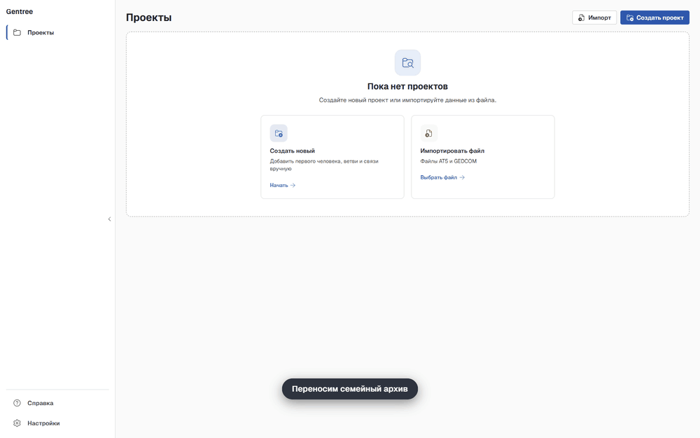
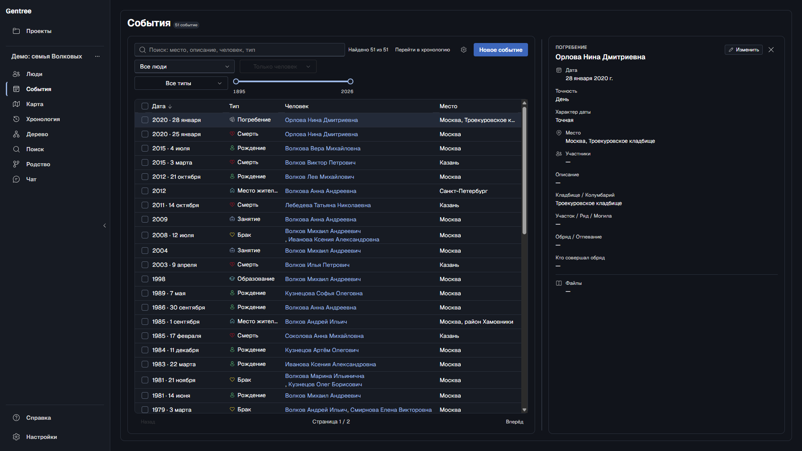

<h1 align="center">Gentree</h1>

<p align="center">
  <strong>Семейный архив, который остаётся у вас.</strong><br>
  Люди, события, фотографии и источники в одной папке проекта — и дерево,
  которое не превращается в клубок, когда семья разрастается.
</p>

<p align="center">
  <a href="README.md">English</a> ·
  <a href="#возможности">Возможности</a> ·
  <a href="#установка">Установка</a> ·
  <a href="#приватность">Приватность</a> ·
  <a href="#участие">Участие</a>
</p>

<p align="center">
  <a href="https://github.com/marakogr/gentree/releases/latest"></a>
</p>

<p align="center">
  
</p>

<p align="center">
  <a href="LICENSE"></a>
  <a href="https://github.com/marakogr/gentree/releases"></a>
  
  
  
</p>

> **Ранняя предварительная версия.** Gentree работает и покрыт тестами, но
> интерфейс и формат проекта ещё могут меняться от выпуска к выпуску.
> Приложение само делает резервные копии, но держите и свою — лишней она не
> будет.

Gentree — для коробки с фотографиями, наполовину забытых дат и историй, которые
знает только один родственник. Он даёт всему этому место, которое принадлежит
вам: архив с поиском, дерево, которое удобно читать, хронологию, растущую вместе
с вашим исследованием, и необязательного ИИ-ассистента, который работает с тем
же архивом. Без аккаунта, подписки и облака.

## Зачем это нужно

- **Всё хранится у вас.** Нет сервера Gentree, аккаунтов и телеметрии. Проект —
  это папка с понятными JSON- и JSONL-файлами: её можно скопировать, сохранить
  про запас и прочитать даже без приложения.
- **Не знаете — так и пишете.** Дата может быть точной, примерной или
  неизвестной, с точностью до дня, месяца или года. Gentree не придумывает дату;
  «до», «после» и диапазоны из импортированных файлов сохраняются как есть.
- **Дерево, которое читается.** Предки, потомки и кровные родственники
  раскладываются отдельными семьями, а не одним клубком линий; для любого
  человека можно показать родство с выбранным корнем.
- **Одна строка фильтров, одна история.** «События», «Карта» и «Хронология»
  делят фильтры: человек, связь, тип события, годы. Из событий человека можно
  перейти в хронологию и вернуться обратно, ничего не потеряв.
- **Исследование можно перенести.** Импорт AT5 (формат программы «Древо жизни»)
  и GEDCOM 5.5.1/7.0; экспорт в GEDCOM и JSON/ZIP.
- **Ассистент, который сначала спрашивает.** Любая OpenAI-совместимая модель
  может искать и читать архив. Правит она только после пробного прогона и
  вашего подтверждения.

### Подойдёт ли он вам?

Gentree подходит, если вы хотите хранить исследование в файлах, которые
принадлежат вам, у вас есть архив AT5 или GEDCOM, который нужно перенести, и вам
важны неточные даты и источники.

Пока это не лучший выбор, если нужна совместная работа и публикация в браузере,
подсказки по записям из онлайн-архивов или ДНК-инструменты, мобильное
приложение или готовые установщики для macOS и Linux: выпуски пока только для
Windows.

## Переезд из «Древа жизни»

Gentree открывает архивы AT5 только для чтения: исходный файл не меняется.
Повторный импорт не затирает ваши ручные правки, а всё, что не удалось
разобрать, попадает в отчёт, а не пропадает молча. После импорта дерево можно
выгрузить в GEDCOM 5.5.1 или 7.0.

## Возможности

| Раздел | Что есть |
| --- | --- |
| **Люди** | Несколько имён у человека, отчества, заметки, внешние ID, аватары; быстрая таблица с сортировкой и карточка человека. |
| **События** | От рождения до погребения и свои типы; точность до дня, месяца, года или неизвестная, места с подсказками адресов, участники и файлы. |
| **Хронология** | Датированные события на масштабируемой шкале; события без даты остаются отдельным списком, а не расставляются наугад. |
| **Карта** | События с подтверждённым местом, сгруппированные по местам; есть офлайн-подложка. |
| **Дерево и родство** | Предки, потомки и кровные родственники; выберите двух людей и увидите термин родства, общего предка и путь. |
| **Поиск** | Мгновенный локальный полнотекстовый поиск по именам, биографиям, событиям, местам и источникам. |
| **Файлы** | Фотографии и документы с контрольными суммами; удаление связи никогда не удаляет файл. |
| **Импорт и обмен** | Импорт AT5 только для чтения, импорт и экспорт GEDCOM 5.5.1/7.0, объединение проектов с шагом проверки, JSON/ZIP, автоматические резервные копии. |
| **Качество данных** | Проверки дублей ID, битых ссылок, правил родства и невозможных сроков жизни. |
| **Языки** | Русский, украинский, белорусский, английский, немецкий и испанский. |

Названия вроде «Горький» или «Сталинград» Gentree умеет сопоставлять с
сегодняшними (Нижний Новгород, Волгоград) через Wikidata; в событии при этом
остаётся историческое написание.

### Как это выглядит

<p align="center"><em>Синтетический демо-проект, тёмная тема. Никаких данных реальных архивов.</em></p>

| Предки | Хронология |
| --- | --- |
|  |  |
| **Родство** | **Карта** |
|  |  |

<details>
<summary><strong>Ещё скриншоты</strong></summary>

| Люди | Карточка человека |
| --- | --- |
|  |  |
| **События** | **Карточка события** |
|  |  |
| **Потомки** | **Поиск по биографии** |
|  |  |

</details>

## ИИ-ассистент, встроенный в Gentree

Это не просмотрщик с приклеенным чатом. В Gentree есть каталог доменных
инструментов и встроенные генеалогические инструкции, поэтому
OpenAI-совместимая модель работает с тем же архивом, который вы видите на
экране, а не болтает в общем чате, ничего не зная о вашем дереве.

- **Режим чтения.** Модель умеет искать, читать людей, события и источники,
  проходить по предкам и хронологии, находить путь между двумя людьми, объяснять
  родство и проверять проект. Текущую дату она запрашивает, а не угадывает
  возраст.
- **Режим правок, по желанию.** Включите правки людей в настройках, и модель
  сможет предлагать изменения. Каждое проверяется пробным прогоном и показывается
  карточкой «было/стало»; пока вы не подтвердите, ничего не записывается.
- **Внутри приложения, любой провайдер.** Инструменты работают в самом
  приложении, MCP-сервер ни на каком порту не слушает. Пока вы не настроили
  провайдера, чат ничего никуда не отправляет.

Ассистент — помощник, а не авторитет: источники и цитаты остаются в архиве.
Настройка: [`docs/ru/configuration.md`](docs/ru/configuration.md).

## Приватность

Ваш проект — папка на вашем диске. У Gentree нет бэкенда, аккаунтов и
телеметрии. В сеть приложение выходит только в таких случаях:

- **Чат.** Выключен, пока вы его не включите и не настроите провайдера. Тогда
  ваши вопросы и нужные модели части архива уходят выбранному провайдеру.
- **Подсказки адресов.** **Включены по умолчанию.** Вводимый текст места
  отправляется в Photon, DaData или в оба сервиса. Выключите в настройках, и
  ничего отправляться не будет.
- **Исторические названия.** **Включены по умолчанию.** Название вроде
  «Горький» отправляется в Wikidata, чтобы показать сегодняшний Нижний Новгород.
  Выключается в настройках.
- **Тайлы карты.** Только пока открыта вкладка «Карта» с онлайн-подложкой;
  сервер тайлов видит примерную область просмотра, но не архив. Есть офлайн-контур.
- **Обновления.** По умолчанию выключены. Gentree обращается к серверу
  обновлений, только когда вы включите проверку при запуске или нажмёте
  **Проверить обновления**.

API-ключи хранятся в переменных окружения, а не в git, папке проекта или
журналах. В этом репозитории нет реальных архивов, тесты используют только
синтетические данные. У проекта один писатель, запись атомарна, а манифест
содержит контрольную сумму, поэтому прерванное сохранение не повредит архив
незаметно. Подробности и переключатели:
[`docs/ru/configuration.md`](docs/ru/configuration.md).

## Установка

**Windows 10 (1803+) и 11, x64.** Скачайте установщик или портативный архив на
странице [Releases](https://github.com/marakogr/gentree/releases) и сверьте
загрузку с `SHA256SUMS-windows-x64.txt`. Сборки пока не подписаны, поэтому при
первом запуске SmartScreen может попросить подтверждение; шаги и требование к
WebView2 описаны в [`docs/ru/install.md`](docs/ru/install.md).

**macOS и сборка из исходников.** Нужны Rust 1.88+, Node.js 20+ и нативный
набор инструментов.

```bash
make setup    # первичная подготовка: Rust, зависимости UI, git-хуки
make check    # формат, clippy, тесты Rust, typecheck/тесты/сборка/i18n UI
make dev      # запуск приложения в режиме разработки
```

`make doctor` подскажет, чего не хватает. Подробнее —
[`docs/ru/install.md`](docs/ru/install.md) и
[`desktop/docs/build.md`](desktop/docs/build.md).

### Первый проект

1. **Откройте или создайте проект.** Импортируйте архив AT5 или файл GEDCOM либо
   начните с пустого.
2. **Добавьте людей и свяжите их.** Связи «родитель — ребёнок», супруги,
   партнёры и усыновление задаются явно. Братья и сёстры вычисляются по общим
   родителям.
3. **Добавьте события.** Даты могут быть неполными. Событие за пределами
   известной жизни человека форма не сохранит.
4. **Изучайте.** Переключайте дерево между предками, потомками и кровными
   родственниками, а на хронологии читайте семью как историю.

## Форматы и совместимость

- **AT5** при импорте открывается только для чтения и никогда не изменяется.
- **GEDCOM 5.5.1 и 7.0**: версия при импорте определяется по заголовку. Экспорт
  доступен в обеих версиях, по умолчанию 5.5.1; 7.0 дополнительно пишет
  источники и цитаты. Проблемы импорта выводятся предупреждениями, записи не
  пропадают молча.
- **JSON/ZIP** — обмен целыми проектами. Объединение сначала показывает шаг
  проверки.
- **Формат проекта версионирован.** Старые сборки отказываются открывать более
  новый проект, а не теряют данные; старый проект обновляется при первом
  изменении.

## Как это устроено

| Слой | Технологии |
| --- | --- |
| Оболочка | Tauri 2 |
| Домен и хранение | Rust workspace; `core` — чистая логика без ввода-вывода, `storage` владеет папкой проекта |
| UI | React 18, Vite, Tailwind, Fluent UI |
| Поиск | Tantivy |
| Локальные данные | JSON-манифест + коллекции JSONL, файлы с контрольными суммами |
| Импорт | AT5 (SQLite только для чтения), GEDCOM 5.5.1/7.0, JSON/ZIP |
| Чат | OpenAI-совместимый HTTP-провайдер с инструментами внутри приложения |

Заметки об архитектуре — в [`openwiki/quickstart.md`](openwiki/quickstart.md),
правила, которым следует код, — в [`AGENTS.md`](AGENTS.md).

## Участие

Идеи, отчёты об ошибках, переводы, документация и код приветствуются.
Запланированная работа отслеживается в
[вехах](https://github.com/marakogr/gentree/milestones).

- `main` защищена: работайте в короткой ветке `change/<name>` и открывайте
  pull request. Коммиты — Conventional Commits (`feat(desktop): ...`).
- Перед PR запускайте `make check`.
- Никогда не прикладывайте данные реальных архивов к issue или тестам;
  используйте синтетические примеры (в [`demo/`](demo/README.md) есть генератор).
- Прочитайте [`CONTRIBUTING.md`](CONTRIBUTING.md) и [`AGENTS.md`](AGENTS.md).
  Сообщения об уязвимостях: [`SECURITY.md`](SECURITY.md).

## Лицензия

[MIT](LICENSE) © Gentree contributors.

Встроенные шрифты интерфейса Medeo Sans, Medeo Mono и Medeo Pixel
([`desktop/ui/src/assets/fonts/OFL.txt`](desktop/ui/src/assets/fonts/OFL.txt))
© 2026 The Medeo Project Authors, лицензия SIL Open Font License 1.1.
