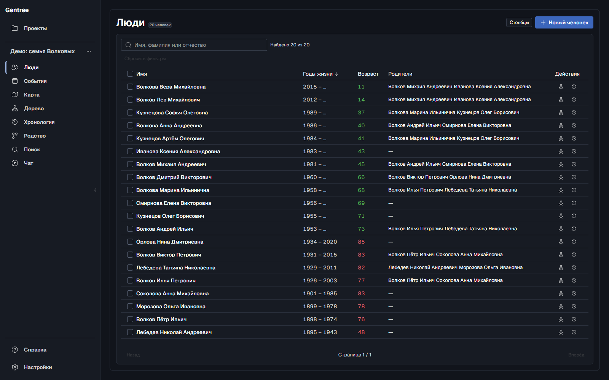
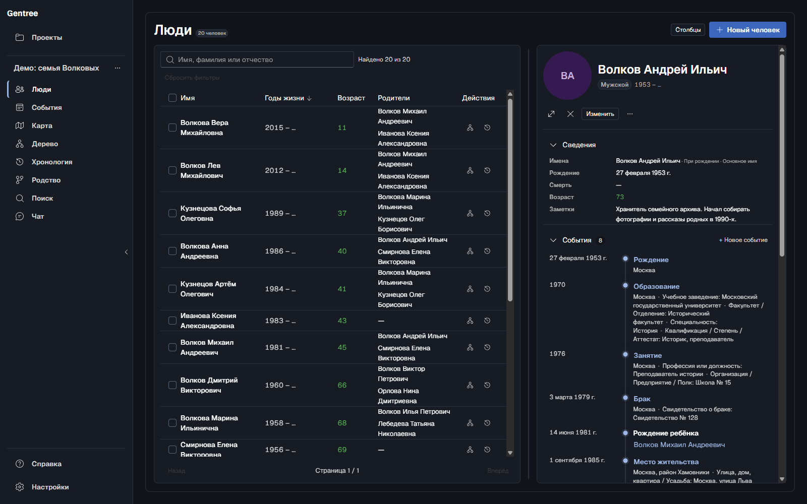
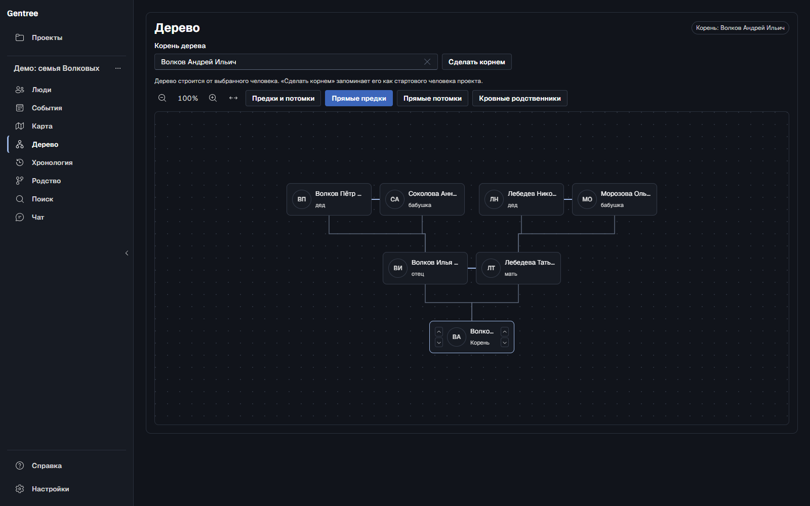
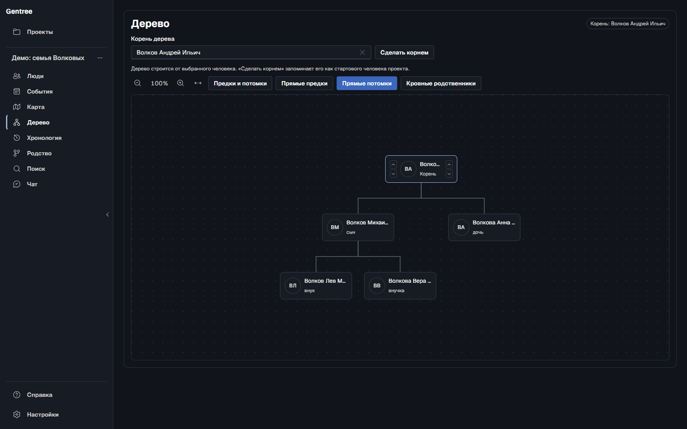
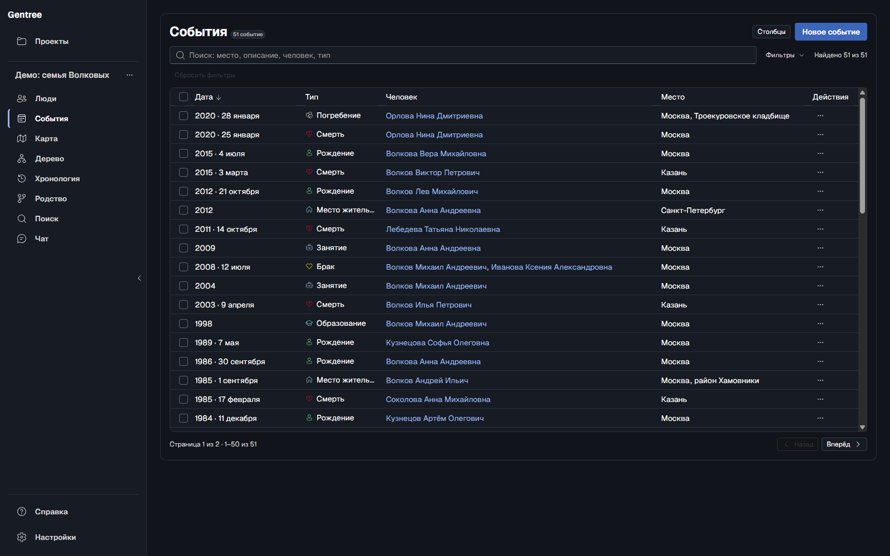
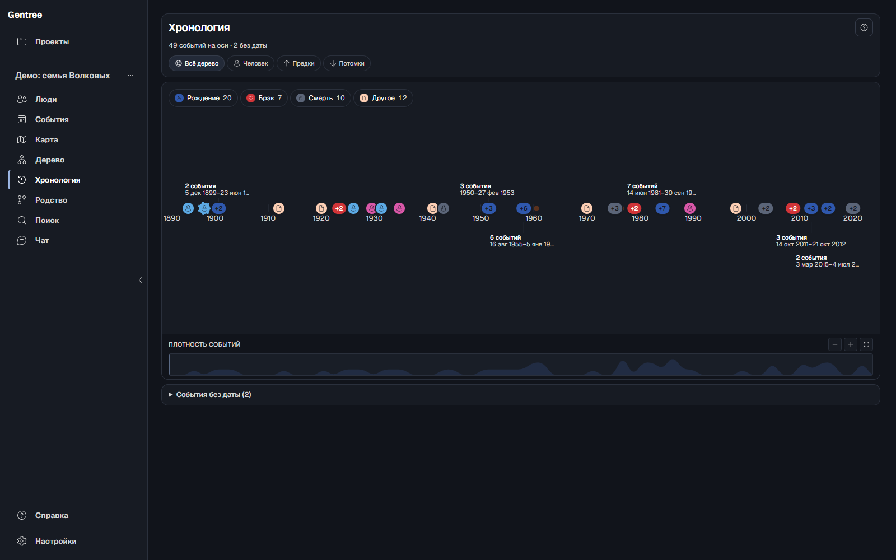
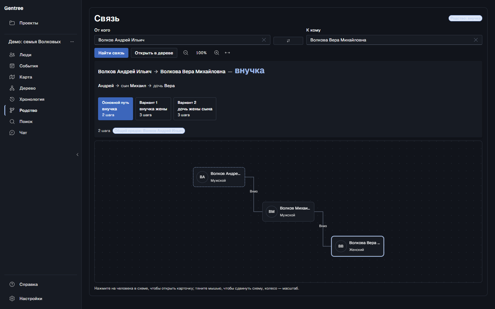
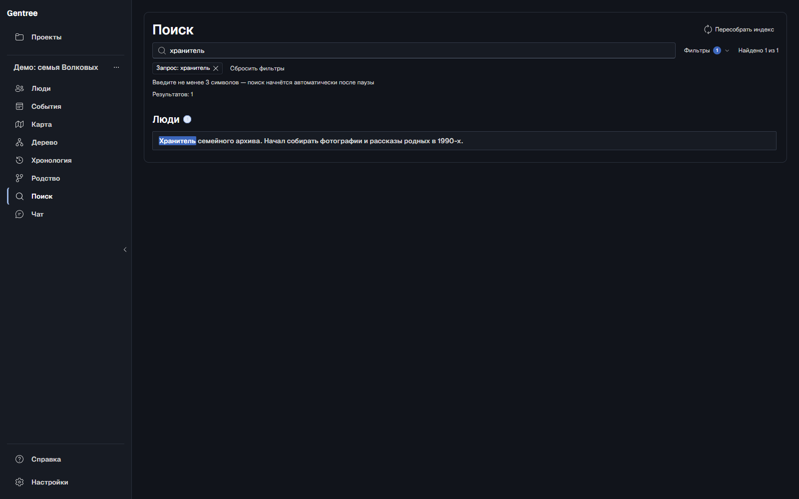
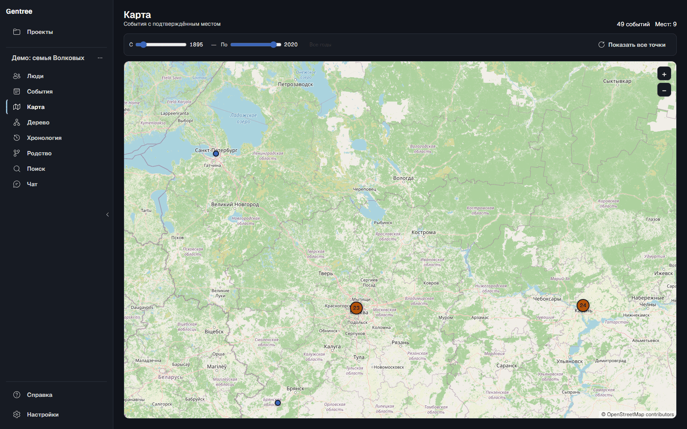

<h1 align="center">Gentree</h1>

<p align="center">
  <strong>Семейный архив, который остаётся у вас.</strong><br>
  Люди, события, фотографии и источники в одной папке проекта — и дерево,
  которое не превращается в клубок, когда семья разрастается.
</p>

<p align="center">
  <a href="README.md">English</a> ·
  <a href="#быстрый-старт">Быстрый старт</a> ·
  <a href="#возможности">Возможности</a> ·
  <a href="#как-это-устроено">Архитектура</a> ·
  <a href="CONTRIBUTING.md">Участие</a>
</p>

<p align="center">
  <a href="LICENSE"></a>
  
  
  
  
  <a href="CONTRIBUTING.md"></a>
</p>

> **Статус: ранняя предварительная версия (0.2.x).** Gentree работает и покрыт
> тестами, но интерфейс и формат проекта ещё могут меняться от выпуска к
> выпуску. Приложение само делает резервные копии, но держите и свою — лишней она
> не будет.

Gentree — для коробки с фотографиями, наполовину забытых дат и историй, которые
знает только один родственник. Он даёт всему этому место, которое принадлежит
вам: архив с поиском, дерево, которое удобно читать, хронологию, растущую вместе
с вашим исследованием, и ИИ-ассистента, который работает с тем же архивом —
свободно читает и пишет только с вашего подтверждения. Без аккаунта, подписки и
облака.

## Зачем это нужно

Большинство генеалогических сервисов просят зарегистрироваться, загрузить
исследование к себе на сервер и доверить его им. Gentree устроен наоборот: одно
настольное приложение, одна папка проекта, ваши данные.

- **Всё хранится у вас.** Нет сервера Gentree, аккаунтов и телеметрии. Проект —
  это папка с понятными JSON- и JSONL-файлами: её можно скопировать, сохранить
  про запас или заархивировать и прочитать даже без приложения.
- **ИИ-ассистент, который знает ваше дерево.** В Gentree есть собственный каталог
  инструментов и встроенные генеалогические навыки, поэтому любая
  OpenAI-совместимая модель может искать по архиву, читать людей и события,
  проходить по предкам, работать с хронологией, объяснять родство и проверять
  данные. Режим правок включается отдельно: модель предлагает изменение,
  приложение проверяет его вхолостую, и ничего не сохраняется без вашего
  подтверждения.
- **Не знаете — так и пишете.** Дата может быть точной, примерной или неизвестной,
  с точностью до дня, месяца или года. Gentree не придумывает дату для факта,
  который вы не установили, а «до», «после» и диапазоны из импортированных
  файлов сохраняются и показываются как есть.
- **Дерево, которое читается.** Предки, потомки и кровные родственники
  раскладываются отдельными семьями, а не одним клубком линий. Для любого
  человека можно показать родство с выбранным корнем.
- **Хронология.** Датированные события ложатся на
  масштабируемую шкалу с фильтрами по человеку, типу, месту и году. События без
  даты остаются отдельным списком, а не расставляются наугад.
- **Исследование можно перенести.** Импорт архивов AT5 и файлов GEDCOM 5.5.1
  или 7.0, объединение проектов, экспорт в любую из версий GEDCOM, обмен
  проектами в JSON и ZIP.
- **Всё в одном месте.** События, хронология, фотографии, документы, источники,
  цитаты, полнотекстовый поиск и проверка данных — без десятка вкладок.

## Возможности

| Раздел | Что внутри |
| --- | --- |
| **Люди** | Несколько имён у одного человека (в том числе фамилия при рождении), отчества, пол, заметки, внешние идентификаторы, аватары; быстрая сортируемая таблица и карточка человека. |
| **События** | Рождение, смерть, брак, развод, погребение, проживание, занятие, образование и ваши собственные типы. Точность до дня, месяца, года или «неизвестно», места с подсказками адресов и подбором исторических названий, дополнительные поля для каждого типа, участники. |
| **Хронология** | Масштабируемая лента событий с датами и фильтрами по человеку, типу, месту и году. События без даты лежат в отдельном списке, а не расставляются наугад. |
| **Карта** | События с подтверждённым местом на карте с перемещением и масштабом и фильтром по годам. Точки объединяются по месту и кластеризуются при отдалении; при открытии карты сетевых запросов нет. |
| **Дерево и родство** | Предки, потомки и кровные родственники, пары супругов, приёмные связи и подписи родства относительно любого корня. Дерево всего проекта без корня — экспериментальный режим под флагом в настройках. |
| **Режим «Родство»** | Выберите двух людей и увидите, кем они приходятся друг другу: термин, общего предка, длину пути, альтернативные пути и схему. |
| **Поиск** | Мгновенный поиск по именам, биографиям, описаниям событий, местам и источникам на локальном индексе Tantivy. |
| **Медиа** | Фотографии и документы, фото профиля, открытие в системном просмотрщике, сохранение копий. У файлов есть контрольные суммы, а удаление связи никогда не удаляет сам файл. |
| **Импорт и обмен** | Импорт AT5 только для чтения, импорт и экспорт GEDCOM 5.5.1/7.0 (по умолчанию 5.5.1), объединение проектов с шагом проверки, экспорт и импорт JSON/ZIP, автоматические резервные копии с восстановлением. |
| **Качество данных** | Проверки на повторяющиеся идентификаторы, битые ссылки, правила связей, дубли рождения и смерти; при добавлении и правке события проверяется, укладывается ли оно в годы жизни. |
| **ИИ-ассистент (по желанию)** | Любой OpenAI-совместимый endpoint, потоковые ответы, 14 инструментов чтения внутри процесса (поиск, люди, события, источники, предки, хронология, путь, родство, проверка, бэкапы) и отдельный инструмент правки человека. 12 встроенных навыков ведут модель по генеалогическим задачам; каждая запись сначала проверяется вхолостую и требует подтверждения. |
| **Справка и версия** | Встроенное руководство с поиском и передачей вопроса ассистенту, а также версия программы в «Настройках» → «О программе». |
| **Языки** | Русский, украинский, белорусский, английский, немецкий и испанский. |

## Как это выглядит

<p align="center"><em>Скриншоты синтетического демо-проекта в тёмной теме. Реальных данных на них нет.</em></p>

| Люди | Карточка человека |
| --- | --- |
|  |  |
| **Предки** | **Потомки** |
|  |  |
| **События** | **Хронология** |
|  |  |
| **Родство** | **Поиск по биографии** |
|  |  |

В демо-проекте запрос `хранитель` находит биографию хранителя семейного архива,
а запрос `пропал` — ещё и запись о смерти.

### Карта

События с подтверждённой точкой на карте с перемещением и масштабом, с фильтром
по годам. Точки группируются по месту и объединяются в кластеры при отдалении;
при открытии вкладки сетевых запросов нет, пока не загружаются необязательные
онлайн-тайлы.

<p align="center"></p>

## ИИ-ассистент, встроенный в Gentree

Gentree — не просмотрщик с чатом сбоку. Внутри приложения есть каталог
инструментов и набор встроенных генеалогических навыков, поэтому любая
OpenAI-совместимая модель становится полноценным ассистентом по тому же архиву,
который видите вы, а не общим чатом, который ничего не знает о вашем дереве.

**Режим чтения.** Когда чат включён, модель получает 14 инструментов: проект и
обзор дерева, полнотекстовый поиск, человека с событиями, родственниками,
медиа и цитатами, отдельное событие или источник, предков, хронологию, путь
между двумя людьми, родство, проверку проекта, резервные копии и текущую дату —
чтобы возраст не приходилось угадывать.

**Режим правок — по желанию.** Включите правки человека в настройках, и модель
сможет предложить изменения имён, дат, пола или заметок. Каждое предложение
сначала проверяется вхолостую и показывается карточкой «было → стало»; в архив
ничего не попадает, пока вы не подтвердите. Ожидаемые версии защищают правки,
сделанные вами в интерфейсе за это время.

**Не только инструменты, но и навыки.** В приложение встроены 12 руководств:
поиск человека, семейные связи, даты, работа с хронологией, источники и
доказательства, исследование мест, профиль человека, обзор дерева, аудит качества
данных, рекомендации по исследованию, правка человека и передача правок. Они
задают модели те же правила, по которым живёт Gentree: ссылаться на источники,
уважать неточные даты, не выдумывать родственников и не угадывать места.

**Любой провайдер, всё внутри процесса.** Подойдёт любой OpenAI-совместимый
endpoint с потоковыми ответами. Инструменты работают внутри приложения, а не на
MCP-сервере, который слушает порт. Ключ хранится в переменной окружения, и пока
провайдер не настроен, чат ничего никуда не отправляет.

> Ассистент — помощник, а не источник истины. Источники и цитаты остаются в
> архиве, а каждая запись требует вашего подтверждения.

## Приватность

Проект — это папка на вашем диске, своего бэкенда у Gentree нет. В интернет
приложение выходит только в четырёх случаях, и все четыре вы контролируете:

- **Чат.** Выключен, пока вы его не включите и не настроите провайдера. После
  этого ваши вопросы и те части архива, которые нужны модели для ответа, уходят
  выбранному вами провайдеру.
- **Подсказки адресов.** **Включены по умолчанию.** Пока вы вводите место,
  введённый текст отправляется сервису геокодирования (Photon, DaData или обоим).
  Отключить подсказки можно в настройках, и тогда ничего не отправляется.
  Подробности — [в разделе про подсказки](#быстрый-старт) ниже.
- **Исторические названия.** **Включены по умолчанию.** Название вроде
  «Горький» дополнительно отправляется в Wikidata, которая может указать на
  современный Нижний Новгород. В событии остаётся исторический текст, а
  современное название показывается рядом. Переключатель — в настройках.
- **Тайлы карты.** Только пока открыта вкладка «Карта» и выбрана подложка
  `osm`. Сервер тайлов видит примерный регион просмотра, а не архив. В
  настройках можно переключиться на встроенный офлайн-контур.

Что ещё важно:

- Ключи API хранятся в переменных окружения, а не в git, папке проекта или логах.
- В репозитории нет реальных архивов. Тесты используют только синтетические
  данные, а локальные эталоны AT5 лежат вне git.
- У проекта один писатель. Запись атомарная, а в манифесте есть контрольная
  сумма, поэтому прерванное сохранение не испортит архив молча.

## Быстрый старт

### Установить готовую сборку

Скачайте последний установщик для Windows (NSIS `.exe`) или портативный архив
для Windows на странице [Releases](../../releases). Сверьте загрузку с
`SHA256SUMS-windows-x64.txt` рядом с файлами.

Релизы пока только для Windows; сборка для macOS не публикуется.
Предварительные сборки пока не подписаны, поэтому при первом запуске Windows
SmartScreen может попросить подтверждения. Портативный архив описан в
[`docs/portable.md`](docs/portable.md).

#### Windows пишет «Windows protected your PC»

Сборки пока не подписаны, поэтому при первом запуске установщика или
портативного exe SmartScreen предупреждает о неизвестном издателе. Это не
значит, что файл опасен:

1. Нажмите **More info**, затем **Run anyway**.
2. Перед запуском сверьте контрольную сумму:

   ```powershell
   Get-FileHash .\Gentree_0.2.0_x64-setup.exe -Algorithm SHA256
   ```

   Значение должно совпасть со строкой для этого файла в
   `SHA256SUMS-windows-x64.txt` из того же релиза.

На Windows 11 **Smart App Control** блокирует неподписанные приложения без
исключения для конкретной программы. Отключать его — общесистемное изменение
безопасности, не стоит делать это ради одного приложения. Подпись планируется:
подписанная сборка не упрётся ни в одну из этих проверок.

### Собрать из исходников

Понадобятся Rust 1.88 или новее (в репозитории зафиксирован 1.99.1, см.
`desktop/rust-toolchain.toml`), Node.js 20+ с npm и системные инструменты сборки:
MSVC Build Tools и Windows SDK на Windows или Xcode Command Line Tools на macOS.

```bash
make setup    # разовая подготовка: Rust toolchain, зависимости UI, git hooks
make check    # формат, clippy, тесты Rust, typecheck/тесты/сборка/i18n UI
make dev      # запуск приложения в режиме разработки
```

Если чего-то не хватает, `make doctor` проверит Node, Rust, зависимости UI и
системный линкер и подскажет, как исправить каждый пункт. Сборка установщика:

```bash
make build    # .msi + NSIS .exe на Windows, .dmg на macOS
make run      # release-сборка и запуск
```

Подробнее — в [`desktop/docs/build.md`](desktop/docs/build.md). Одного
`cargo build` недостаточно: в режиме разработки Tauri ждёт Vite на
`localhost:1420`.

Подпись релизов и автообновление описаны в
[`docs/releases.md`](docs/releases.md). Preview-сборки не подписаны, а updater
остаётся отключённым, пока не настроены ключ подписи и публичный endpoint.

### Первый проект

1. **Откройте или создайте проект.** Импортируйте архив AT5 или файл GEDCOM либо
   начните с пустого.
2. **Добавьте людей и связи.** Родитель, ребёнок, супруг, партнёр и приёмная
   связь задаются явно. Братья и сёстры определяются по общим родителям.
3. **Добавьте события.** Даты можно вводить не полностью. Если событие выходит за
   известные годы жизни человека, форма не даст его сохранить.
4. **Изучайте.** В разделе **Дерево** можно переключаться между предками,
   потомками и кровными родственниками, а **Хронология** позволяет прочитать
   историю семьи как рассказ.

### Демо-данные

В [`demo/project`](demo/project) лежит полностью синтетический проект: 20 людей,
51 событие и 31 связь. Из него сделаны скриншоты выше, и на нём удобно впервые
посмотреть приложение. Как пересобрать проект и переснять скриншоты — в
[`demo/README.md`](demo/README.md).

### Настройка ИИ-ассистента

Откройте **Настройки → Чат**, включите его и укажите OpenAI-совместимый endpoint.
Ключ API читается из переменной окружения, имя которой вы задали в настройках
(например, `GENTREE_CHAT_API_KEY`). В проекте он не сохраняется и в интерфейсе не
показывается.

Ассистент начинает в режиме чтения с 14 инструментами по проекту. Чтобы он мог
предлагать правки человека, включите **Разрешить ассистенту редактировать**:
каждое изменение проверяется вхолостую и показывается на подтверждение, прежде
чем попасть в архив.

<details>
<summary><strong>Подсказки адресов: провайдеры и настройка</strong></summary>

Подсказки для поля `place` события и для адреса в `RESIDENCE` **включены по
умолчанию** и отключаются в настройках. Пока они выключены, ни запросы, ни
адреса не покидают ваш компьютер.

```yaml
geocoder:
  enabled: true                  # пока false, запросов нет
  provider: both                 # photon | dadata | both
  photon_base_url: https://photon.komoot.io/api/
  dadata_base_url: https://suggestions.dadata.ru/suggestions/api/4_1/rs/suggest/address
  api_key_env: DADATA_API_KEY    # имя переменной окружения, не сам ключ
  timeout_seconds: 10
historical_geocoder:
  enabled: true                  # исторические названия через Wikidata
  api_url: https://www.wikidata.org/w/api.php
  timeout_seconds: 10
```

- **Photon** (OpenStreetMap) покрывает весь мир, **DaData** точнее для российских
  адресов. В режиме `both` запросы без кириллицы идут в Photon, а запросы с
  кириллицей — сначала в DaData, потом в Photon; результаты объединяются.
- Подсказки не обязательны: место всегда можно ввести вручную.
- **Исторические названия** («Горький», «Сталинград», «Ленинград») ищутся в
  Wikidata (CC0). В событии остаётся исторический текст, современное название
  показывается рядом. Отправляется только название места; переключатель можно
  выключить.
- У DaData есть бесплатная дневная квота, дальше — платные тарифы. Публичный
  Photon работает по принципу fair use; в `photon_base_url` можно указать
  собственный сервер.

</details>

<details>
<summary><strong>Карта: подтверждённые точки и тайлы</strong></summary>

Вкладка «Карта» показывает события с **подтверждённой точкой**. Точка
записывается только когда вы выбираете подсказку адреса (или ставите её
вручную); по одному названию места приложение никогда не геокодирует. События
из старых проектов остаются в списке «места без координат», пока вы не
подтвердите их — по одному месту за раз.

При открытии карты сетевых запросов нет. Тайлы запрашиваются только пока
открыта вкладка; сервер тайлов видит примерный регион просмотра, а не архив.
В настройках можно переключиться на встроенный офлайн-контур (Natural Earth)
или указать свой сервер в `map.tile_url`:

```yaml
map:
  basemap: osm                    # osm | offline
  tile_url: https://tile.openstreetmap.org/{z}/{x}/{y}.png
```

</details>

<details>
<summary><strong>Свои поля событий</strong></summary>

У встроенных типов событий есть готовый набор полей. Чтобы добавить свои,
отредактируйте глобальный `config.yaml` (он хранится вместе с приложением, а не в
проекте) или откройте **Настройки → Поля событий**:

```yaml
event_fields:
  custom:
    - type: OCCUPATION          # код встроенного типа или название вашего типа
      fields:
        - key: military_rank    # постоянный идентификатор в snake_case
          label: Воинское звание
          multiline: false      # необязательно, по умолчанию false
```

Ключи и названия — настройка всего приложения, а введённые значения хранятся в
проекте. Если ключ потом пропал из конфига, значения не теряются и показываются
под исходным ключом. При экспорте в GEDCOM распространённые факты записываются
стандартными тегами, а остальное попадает в заметку `[gentree:details]`.

</details>

## Как это устроено

| Слой | Технология |
| --- | --- |
| Оболочка | Tauri 2 |
| Домен и хранение | Rust workspace; `core` — чистая логика без I/O, папкой проекта управляет `storage` |
| Интерфейс | React 18, Vite, Tailwind, Fluent UI |
| Поиск | Tantivy |
| Данные | JSON-манифест и JSONL-коллекции, контрольные суммы медиа |
| Импорт | AT5 (SQLite только для чтения), GEDCOM 5.5.1/7.0, JSON/ZIP |
| Чат | OpenAI-совместимый HTTP-провайдер; 14 инструментов чтения внутри процесса, отдельный инструмент правки человека, 12 встроенных навыков |

```text
desktop/
  apps/desktop/              # оболочка Tauri и IPC-команды
  crates/
    core/                    # люди, события, связи, даты, валидация
    storage/                 # папка проекта: манифест, JSONL, бэкапы
    search/                  # индекс Tantivy
    import/                  # AT5, GEDCOM, JSON/ZIP
    config/                  # слои конфигурации и переменные GENTREE_*
    chat/                    # провайдер, промпты, встроенные навыки
    mcp/                     # каталог инструментов для чата внутри процесса (не сетевой сервер)
  ui/                        # интерфейс на React
docs/
  launcher.md                # лента версий и обновление лаунчера
  portable.md                # портативная сборка для Windows
  releases.md                # выпуск, подписи и проверка артефактов
```

## Форматы и совместимость

- **AT5** — формат программы «Древо жизни». При импорте архив открывается только для чтения и никогда не изменяется.
- **GEDCOM 5.5.1 и 7.0** можно импортировать; версия определяется по заголовку.
  Экспорт предлагает обе версии и по умолчанию использует 5.5.1 ради
  совместимости; 7.0 дополнительно записывает источники и цитаты. Проблемы
  импорта показываются как предупреждения, а не приводят к тихой потере записей.
- **JSON/ZIP** — для обмена проектами. Перед объединением показывается шаг
  проверки, а резервные копии создаются автоматически.
- **Формат проекта версионируется.** Он хранит дополнительные поля событий,
  подтверждённые точки на карте и связи файлов с событиями. Старые сборки для
  разработки откажутся открыть более новый проект, чтобы не потерять эти данные.
  Более старый проект обновляется при первом же изменении.
- Поддерживаемые платформы: Windows 10/11 (x64) и macOS 11+.

## Участие

Мы рады идеям, сообщениям об ошибках, переводам, документации и коду.

- Ветка `main` защищена. Работайте в короткой ветке `change/<name>` и открывайте
  pull request.
- Коммиты пишем по Conventional Commits: `feat(desktop): ...`, `fix(ui): ...`.
- Перед PR запустите `make check` (или `make ci`).
- Не прикладывайте реальные архивные данные к issue и тестам. Берите синтетические
  примеры.
- Прочитайте [`CONTRIBUTING.md`](CONTRIBUTING.md) и инварианты в
  [`AGENTS.md`](AGENTS.md).
- Об уязвимостях сообщайте по инструкции в [`SECURITY.md`](SECURITY.md).
- Правила сообщества: [`CODE_OF_CONDUCT.md`](CODE_OF_CONDUCT.md).

## Лицензия

[MIT](LICENSE) © Gentree contributors.

Встроенные шрифты интерфейса — Medeo Sans, Medeo Mono и Medeo Pixel
([`desktop/ui/src/assets/fonts/OFL.txt`](desktop/ui/src/assets/fonts/OFL.txt)) —
© 2026 The Medeo Project Authors, лицензия SIL Open Font License 1.1.
