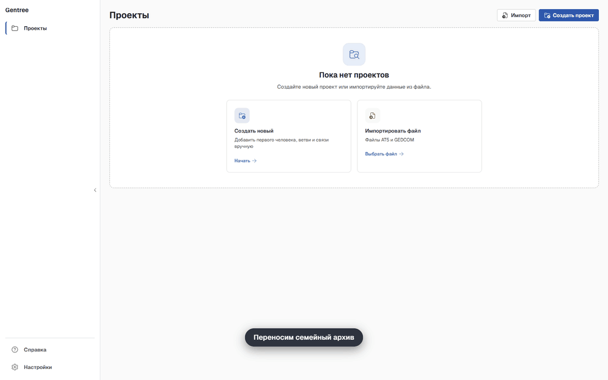
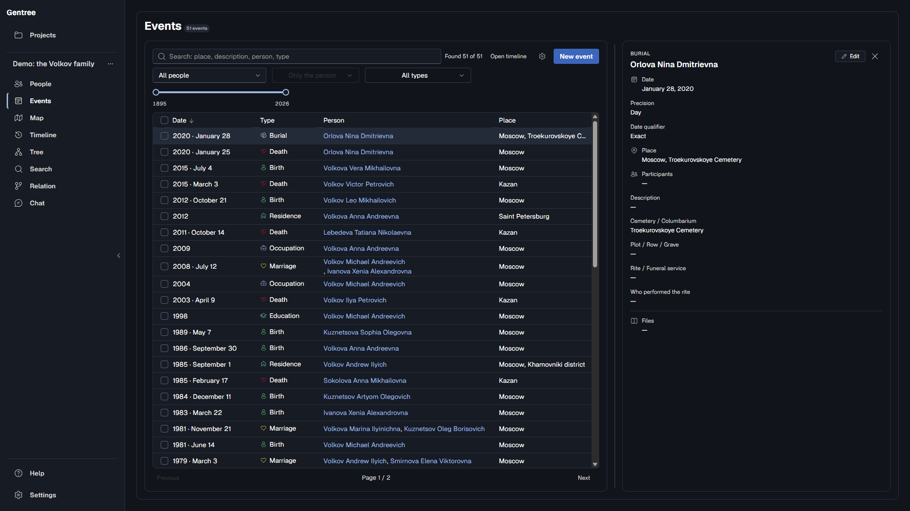

<h1 align="center">Gentree</h1>

<p align="center">
  <strong>A family archive that stays on your computer.</strong><br>
  People, events, photos and sources in one project folder — with a tree
  that stays readable as the family grows.
</p>

<p align="center">
  <a href="README-ru.md">Русский</a> ·
  <a href="#features">Features</a> ·
  <a href="#install">Install</a> ·
  <a href="#privacy">Privacy</a> ·
  <a href="#contributing">Contributing</a>
</p>

<p align="center">
  <a href="https://github.com/marakogr/gentree/releases/latest"></a>
</p>

<p align="center">
  
</p>

<p align="center">
  <a href="LICENSE"></a>
  <a href="https://github.com/marakogr/gentree/releases"></a>
  
  
  
</p>

> **Early preview.** Gentree works and has tests, but the interface and the
> project format can still change between releases. The app makes automatic
> backups; keep a second copy of your own too.

Gentree is for the shoebox of photographs, the half-remembered dates and the
stories only one relative still knows. It gives all of that a home you control:
a searchable archive, a tree you can actually read, a timeline that grows as
your research does, and an optional AI assistant that works on the same
archive. No account, no subscription, no cloud.

## Why Gentree

- **Local-first.** No Gentree server, no accounts, no telemetry. A project is a
  folder of readable JSON and JSONL files that you can copy, back up and read
  without the app.
- **Honest dates.** A date can be exact, approximate or unknown, down to the
  day, month or year. Gentree never invents a date; "before", "after" and range
  dates from imported files are kept as they are.
- **A tree that stays readable.** Ancestors, descendants and blood relatives are
  laid out as separate families instead of one tangle of lines, with kinship
  labels relative to the root you pick.
- **One filter row, one story.** Events, Map and Timeline share the same person,
  relation, type and year filters. Jump from a person's events to the timeline
  and back without losing them.
- **Bring your research along.** AT5 (the Drevo Zhizni program format) and
  GEDCOM 5.5.1/7.0 in; GEDCOM and JSON/ZIP out.
- **An assistant that asks first.** Any OpenAI-compatible model can search and
  read the archive. It edits only after a dry run that you confirm.

### Is it for you?

Gentree fits if you want your research as files you own, you have an AT5 or
GEDCOM archive to bring over, and you care about uncertain dates and sources.

It is not (yet) the right tool if you need real-time collaboration or sharing
in a browser, online record hints or DNA tools, a mobile app, or ready-made
macOS or Linux installers: releases are Windows-only for now.

## Features

| Area | What you get |
| --- | --- |
| **People** | Several names per person, patronymics, notes, external IDs, avatars; a fast sortable table and a detail card. |
| **Events** | Birth to burial plus your own types; day, month, year or unknown precision, places with address suggestions, participants and files. |
| **Timeline** | Dated events on a zoomable scale; undated events stay in their own list instead of being guessed into place. |
| **Map** | Events with a confirmed place, grouped by place; an offline basemap is available. |
| **Tree and kinship** | Ancestor, descendant and blood-relative views; pick two people to see the term, common ancestor and path. |
| **Search** | Instant local full-text search over names, biographies, events, places and sources. |
| **Media** | Photos and documents with checksums; removing a link never deletes the file. |
| **Import and exchange** | Read-only AT5 import, GEDCOM 5.5.1/7.0 import and export, project merge with a review step, JSON/ZIP, automatic backups. |
| **Data quality** | Checks for duplicate IDs, dangling references, relationship rules and impossible lifespans. |
| **Languages** | Russian, Ukrainian, Belarusian, English, German and Spanish. |

### A closer look

<p align="center"><em>Synthetic demo project, dark theme. No real archive data.</em></p>

| Ancestors | Timeline |
| --- | --- |
|  |  |
| **Kinship** | **Map** |
|  |  |

<details>
<summary><strong>More screenshots</strong></summary>

| People | Person card |
| --- | --- |
|  |  |
| **Events** | **Event card** |
|  |  |
| **Descendants** | **Search a biography** |
|  |  |

</details>

## An AI assistant, built in

Gentree is not a viewer with a chat box bolted on. It ships a catalog of
domain tools and embedded genealogy guides, so an OpenAI-compatible model works
on the same archive you are looking at instead of a generic chat that knows
nothing about your tree.

- **Read mode.** The model can search, read people, events and sources, walk
  ancestors and the timeline, find the path between two people, explain kinship
  and validate the project. It asks for the current date instead of guessing ages.
- **Write mode, opt-in.** Turn on person edits in Settings and the model can
  propose changes. Each one is validated in a dry run and shown as a before/after
  card; nothing is written until you confirm.
- **In-process and provider-agnostic.** The tools run inside the app, with no MCP
  server listening on a port. Until you configure a provider, chat sends nothing
  anywhere.

The assistant is a helper, not an authority: sources and citations stay in the
archive. Setup: [`docs/configuration.md`](docs/configuration.md).

## Privacy

Your project is a folder on your disk. Gentree has no backend, no accounts and
no telemetry. The app goes online only in these cases:

- **Chat.** Off until you enable it and configure a provider. Then your
  questions and the parts of the archive the model needs go to that provider.
- **Address suggestions.** **On by default.** The place text you type is sent to
  Photon, DaData or both. Turn it off in Settings and nothing is sent.
- **Historical names.** **On by default.** A name such as "Gorky" is sent to
  Wikidata, which can point to today's Nizhny Novgorod. Switch it off in Settings.
- **Map tiles.** Only while the Map tab is open with the online basemap; the tile
  server sees the approximate viewport, never the archive. An offline outline
  is available.
- **Updates.** Off by default. Gentree contacts the update server only after you
  turn on the startup check or press **Check for updates**.

API keys live in environment variables, never in git, the project folder or logs.
This repository contains no real archives; tests use synthetic data only.
Projects have one writer, writes are atomic, and the manifest carries a checksum,
so an interrupted save can't quietly corrupt your archive. Details and
switches: [`docs/configuration.md`](docs/configuration.md).

## Install

**Windows 10 (1803+) and 11, x64.** Download the installer or the portable
archive from [Releases](https://github.com/marakogr/gentree/releases) and check
it against `SHA256SUMS-windows-x64.txt`. Builds are not code-signed yet, so
SmartScreen may ask you to confirm on first launch; see
[`docs/install.md`](docs/install.md) for the steps and the WebView2 requirement.

**macOS and from source.** You need Rust 1.88+, Node.js 20+ and a native
toolchain.

```bash
make setup    # one-time bootstrap: Rust toolchain, UI deps, git hooks
make check    # format, clippy, Rust tests, UI typecheck/test/build/i18n
make dev      # run the app in dev mode
```

`make doctor` diagnoses a missing toolchain. More in
[`docs/install.md`](docs/install.md) and
[`desktop/docs/build.md`](desktop/docs/build.md).

### Your first project

1. **Open or create a project.** Import an AT5 archive or a GEDCOM file, or
   start empty.
2. **Add people and connect them.** Parent, child, spouse, partner and adoptive
   links are explicit. Siblings are worked out from shared parents.
3. **Add events.** Dates can be partial. An event outside the person's known
   lifespan won't save.
4. **Explore.** Switch the tree between ancestors, descendants and blood
   relatives, then read the family as a story on the timeline.

## Formats and compatibility

- **AT5** is opened read-only on import and never modified.
- **GEDCOM 5.5.1 and 7.0** import detects the version from the header. Export
  offers both and defaults to 5.5.1; 7.0 also writes sources and citations.
  Problems are reported as warnings; records don't quietly disappear.
- **JSON/ZIP** exchanges whole projects. Merging shows a review step first.
- **The project format is versioned.** Older builds refuse to open a newer
  project instead of dropping data; an older project is upgraded the first time
  you change something in it.

## Under the hood

| Layer | Technology |
| --- | --- |
| Desktop shell | Tauri 2 |
| Domain and storage | Rust workspace; `core` is pure logic with no I/O, `storage` owns the project folder |
| UI | React 18, Vite, Tailwind, Fluent UI |
| Search | Tantivy |
| Local data | JSON manifest + JSONL collections, checksummed media |
| Import | AT5 (read-only SQLite), GEDCOM 5.5.1/7.0, JSON/ZIP |
| Chat | OpenAI-compatible HTTP provider with in-process tools |

Architecture notes live in [`openwiki/quickstart.md`](openwiki/quickstart.md);
the rules the code follows are in [`AGENTS.md`](AGENTS.md).

## Contributing

Ideas, bug reports, translations, docs and code are welcome. Planned work is
tracked in the [milestones](https://github.com/marakogr/gentree/milestones).

- `main` is protected: work in a short-lived `change/<name>` branch and open a
  pull request. Commits follow Conventional Commits (`feat(desktop): ...`).
- Run `make check` before opening a PR.
- Never attach real archive data to an issue or a test; use synthetic examples
  ([`demo/`](demo/README.md) has a generator).
- Read [`CONTRIBUTING.md`](CONTRIBUTING.md) and [`AGENTS.md`](AGENTS.md).
  Security reports: [`SECURITY.md`](SECURITY.md).

## License

[MIT](LICENSE) © Gentree contributors.

The bundled UI fonts Medeo Sans, Medeo Mono and Medeo Pixel
([`desktop/ui/src/assets/fonts/OFL.txt`](desktop/ui/src/assets/fonts/OFL.txt))
are © 2026 The Medeo Project Authors, licensed under the SIL Open Font License
1.1.
