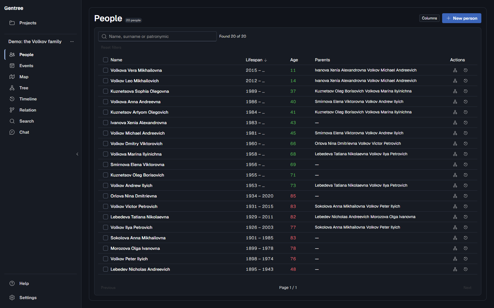
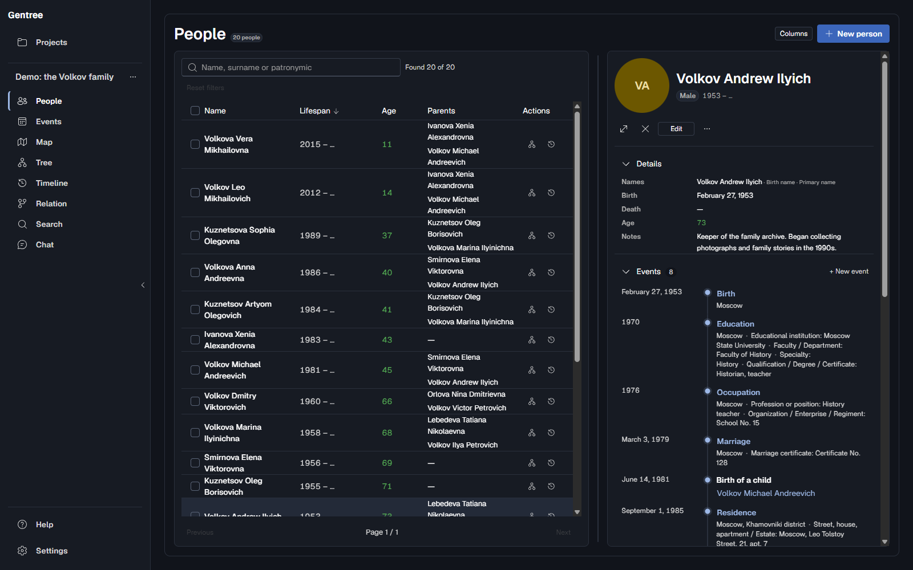
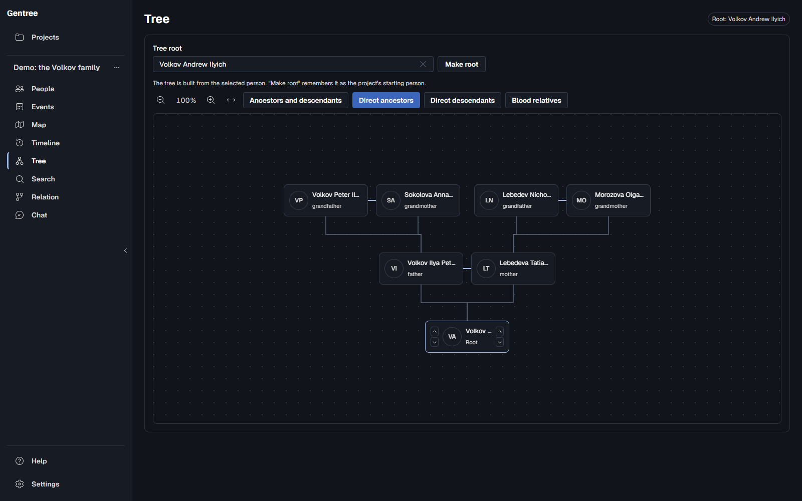
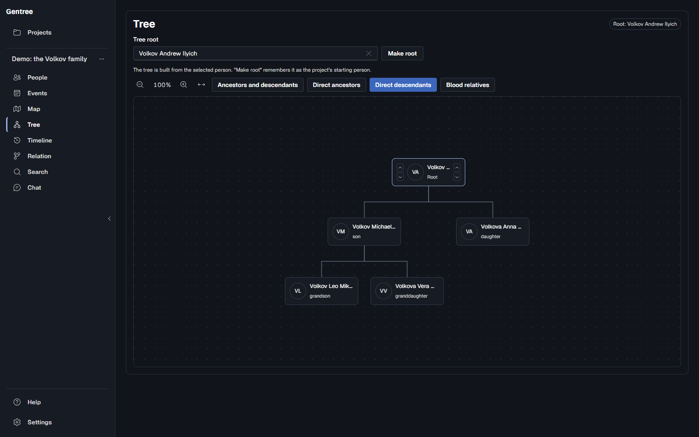
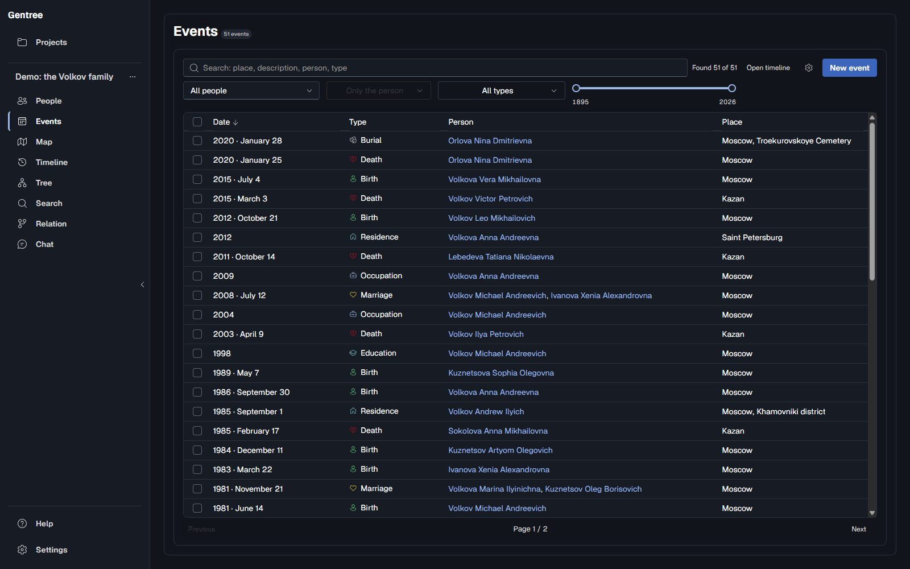
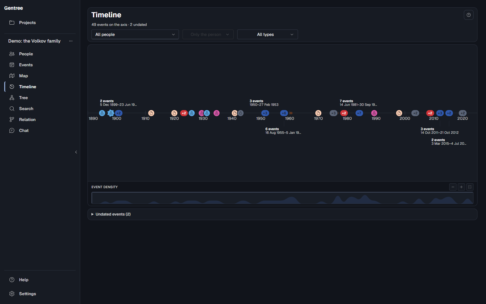
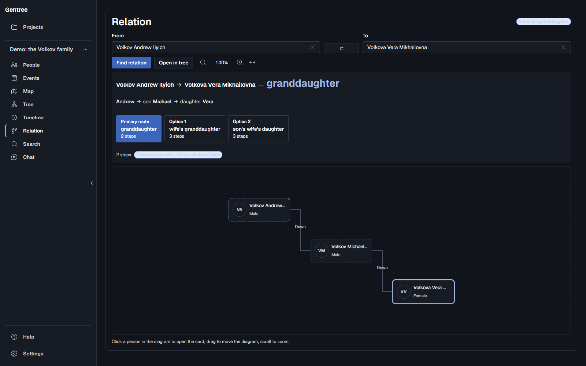
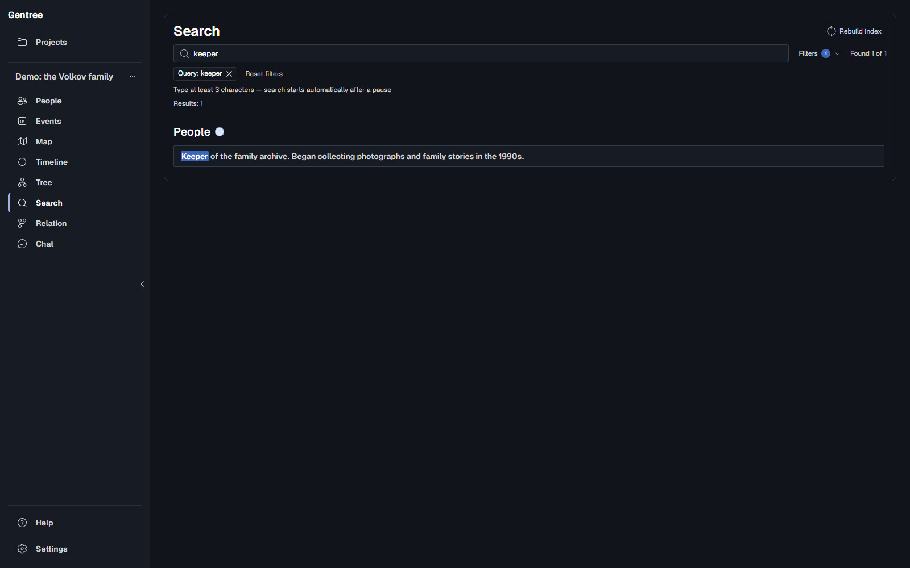
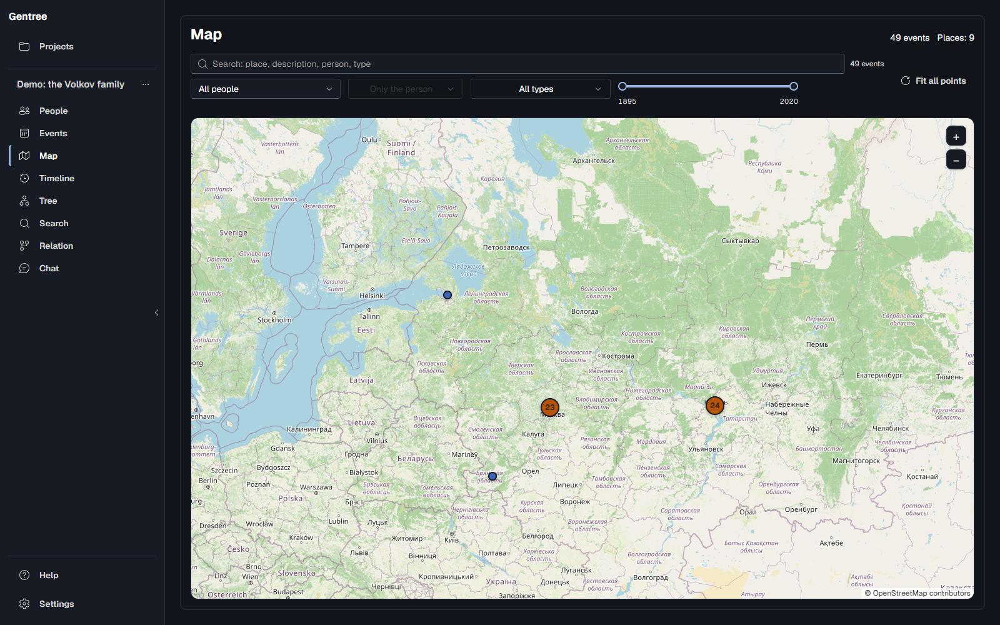

<h1 align="center">Gentree</h1>

<p align="center">
  <strong>A family archive that stays on your computer.</strong><br>
  People, events, photos and sources in one project folder — with a tree
  that stays readable as the family grows.
</p>

<p align="center">
  <a href="README-ru.md">Русский</a> ·
  <a href="#quick-start">Quick start</a> ·
  <a href="#features">Features</a> ·
  <a href="#under-the-hood">Architecture</a> ·
  <a href="CONTRIBUTING.md">Contributing</a>
</p>

<p align="center">
  <a href="LICENSE"></a>
  
  
  
  
  <a href="CONTRIBUTING.md"></a>
</p>

> **Status: early preview (0.2.x).** Gentree works and has tests, but the
> interface and the project format can still change between releases. Keep your
> own backups too — the app makes automatic ones, but a second copy never hurts.

Gentree is for the shoebox of photographs, the half-remembered dates and the
stories only one relative still knows. It gives all of that a home you control:
a searchable archive, a tree you can actually read, a timeline that grows as
your research does, and an optional AI assistant that works on the same
archive — reading freely, writing only with your approval. No account, no
subscription, no cloud.

## Why Gentree

Most genealogy services want you to sign up, upload your research and trust
their servers with it. Gentree works the other way round: one desktop app, one
project folder, your data.

- **Local-first.** There is no Gentree server, no accounts and no telemetry. A
  project is a folder of readable JSON and JSONL files. You can copy it, back it
  up or archive it, and read it without the app.
- **An AI assistant that knows the tree.** Gentree ships its own tool catalog and
  embedded genealogy skills, so any OpenAI-compatible model can search the
  archive, read people and events, walk ancestors, follow the timeline, explain
  kinship and validate data. Write mode is opt-in: the model proposes person
  edits, dry-runs them, and nothing changes until you confirm.
- **It admits what you don't know.** A date can be exact, approximate or unknown,
  down to the day, month or year. Gentree never makes up a date for a fact you
  haven't pinned down, and "before", "after" and range dates from imported files
  are kept and shown as they are.
- **A tree that stays readable.** Ancestors, descendants and blood relatives
  are laid out as separate families instead of one tangle of lines, and any
  person can be labelled with their kinship to the root you pick.
- **A timeline.** Dated events sit on a zoomable scale with
  filters by person, type, place and year. Undated facts stay in their own list
  instead of being guessed into place.
- **Bring your existing research.** Import AT5 archives and GEDCOM 5.5.1 or
  7.0 files, merge projects, export to either GEDCOM version, and exchange
  projects as JSON or ZIP.
- **One place for everything.** Events, timeline, photos, documents, sources,
  citations, full-text search and data checks, without a dozen tabs.

## Features

| Area | What you get |
| --- | --- |
| **People** | Several names per person (including birth surnames), patronymics, gender, notes, external IDs, avatars, and a fast sortable table with a detail card. |
| **Events** | Birth, death, marriage, divorce, burial, residence, occupation, education and your own types. Day, month, year or unknown precision, places with address suggestions and historical-name matching, extra fields per event type, participants. |
| **Timeline** | A zoomable timeline of dated events, filterable by person, type, place and year. Events without a date go into a separate list rather than being guessed into place. |
| **Map** | Events with a confirmed place on a pan/zoom map, filtered by a year range. Points group by place and cluster when zoomed out; opening the map makes no network request. |
| **Tree and kinship** | Ancestor, descendant and blood-relative views, spouse pairs, adoption links, and kinship labels relative to any root. The rootless whole-project forest is an experimental mode behind a settings flag. |
| **Kinship mode** | Pick two people and see how they are related: the term, common ancestor, path length, alternative paths and a diagram. |
| **Search** | Instant search over names, biographies, event descriptions, places and sources, backed by a local Tantivy index. |
| **Media** | Attach photos and documents, pick a profile photo, open files in your system viewer, save copies. Files are checksummed, and removing a link never deletes the file itself. |
| **Import and exchange** | Read-only AT5 import (the Drevo Zhizni program format), GEDCOM 5.5.1/7.0 import and export (5.5.1 by default), project merge with a review step, JSON/ZIP export and import, automatic backups with restore. |
| **Data quality** | Checks for duplicate IDs, dangling references, relationship rules, duplicate birth and death events, and a lifespan check when you add or edit an event. |
| **AI assistant (optional)** | Any OpenAI-compatible endpoint, streaming answers, 14 in-process read tools (search, people, events, sources, ancestors, timeline, path, kinship, validation, backups) and an opt-in person-edit tool. 12 embedded skills guide the model through genealogy tasks; every write is dry-run and confirmed first. |
| **Guide and version** | An offline user guide with search and an "ask the assistant" hand-off, plus the installed version in Settings → About. |
| **Languages** | Russian, Ukrainian, Belarusian, English, German and Spanish. |

## A look inside

<p align="center"><em>Screenshots of the synthetic demo project, dark theme. No real archive data.</em></p>

| People | Person card |
| --- | --- |
|  |  |
| **Ancestors** | **Descendants** |
|  |  |
| **Events** | **Timeline** |
|  |  |
| **Kinship** | **Search a biography** |
|  |  |

In the English demo project, searching for `keeper` finds the biography of the
family's archive keeper; searching for `missing` also finds the death record.

### Map

Events with a confirmed point on a pan-and-zoom map, filtered by year. Points
group by place and cluster when zoomed out; opening the tab makes no network
request until it draws the optional online tiles.

<p align="center"></p>

## An AI assistant, built in

Gentree is not a viewer with a chat box bolted on. It ships a domain tool
catalog and a set of embedded genealogy skills, so an OpenAI-compatible model
becomes a real assistant for the same archive you are looking at — not a generic
chat that knows nothing about your tree.

**Read mode.** When chat is enabled, the model gets 14 read tools: project and
tree overview, full-text search, a person with events, relatives, media and
citations, a single event or source, ancestors, the timeline, the path between
two people, kinship, project validation, backups, and the current date (so ages
are never guessed).

**Write mode, opt-in.** Turn on person edits in Settings and the model can
propose changed names, dates, gender or notes. Every proposal is validated in a
dry run first and shown as a before/after card; nothing is written until you
confirm. Expected versions protect edits you made in the UI in the meantime.

**Skills, not just tools.** The app embeds 12 guides — finding a person, family
relations, dates, timeline work, sources and evidence, place research, person
profile, tree overview, data-quality audit, research guidance, person editing and
edit handoff. They teach the model the same conventions the rest of Gentree
follows: cite sources, respect uncertain dates, never invent a relative, never
guess a place.

**Provider-agnostic and in-process.** Any OpenAI-compatible endpoint with
streaming works. The tools run inside the app; there is no MCP server listening
on a port. The key stays in an environment variable, and until you configure a
provider the chat sends nothing anywhere.

> The assistant is a helper, not an authority. Sources and citations stay in the
> archive, and every write needs your confirmation.

## Privacy

Your project is a folder on your disk, and Gentree has no backend of its own.
The app only goes online in four cases, and you control each:

- **Chat.** Off until you enable it and configure a provider. Once it is on,
  your questions and the parts of the archive the model needs to answer them go
  to the provider you chose.
- **Address suggestions.** **On by default.** While you type a place, the text
  is sent to the geocoding service (Photon, DaData or both). You can turn this
  off in Settings, and while it is off nothing is sent. Details are in the
  [address suggestions section](#quick-start) below.
- **Historical names.** **On by default.** A name such as “Горький” is also
  sent to Wikidata, which can point to today's Нижний Новгород. The event keeps
  the historical text; the modern name is shown next to it. The switch is in
  Settings.
- **Map tiles.** Only while the Map tab is open, and only with the `osm`
  basemap. The tile server sees the approximate viewport, never the archive.
  You can switch to the bundled offline outline in Settings.

Other things worth knowing:

- API keys live in environment variables, never in git, the project folder or
  logs.
- This repository contains no real archives. Tests use synthetic data only, and
  local AT5 baselines are kept outside git.
- There is one writer per project. Writes are atomic and the manifest carries a
  checksum, so an interrupted save can't quietly corrupt your archive.

## Quick start

### Install a build

Download the latest Windows installer (NSIS `.exe`) or the portable Windows
archive from the [Releases](../../releases) page. Check the download against
`SHA256SUMS-windows-x64.txt` next to the artifacts.

Releases are Windows-only for now; the macOS bundle is not published yet.
Preview builds are not code-signed yet, so Windows SmartScreen may ask you to
confirm on first launch. The portable archive is described in
[`docs/portable.md`](docs/portable.md).

Both need Windows 10 version 1803 (build 17134) or newer, or Windows 11, on
x64. The NSIS installer embeds the Microsoft Edge WebView2 bootstrapper and
downloads the runtime when it is missing, so that step needs a network
connection. The portable archive cannot install WebView2: on a machine without
it, run the installer once or install the runtime from Microsoft. After that
the app works offline.

#### Windows says "Windows protected your PC"

The builds are not code-signed yet, so SmartScreen warns about an unknown
publisher the first time you open the installer or the portable executable. It
does not mean the file is unsafe:

1. Click **More info**, then **Run anyway**.
2. Before running, compare the published checksum with your download:

   ```powershell
   Get-FileHash .\Gentree_0.2.0_x64-setup.exe -Algorithm SHA256
   ```

   The value must match the line for that file in
   `SHA256SUMS-windows-x64.txt` from the same release.

On Windows 11, **Smart App Control** blocks unsigned apps with no per-app
exception. Turning it off is a system-wide security change; do not do it just
for one app. Code signing is planned, and a signed build will not trip either
gate.

### Build from source

You need Rust 1.88 or newer (the repository pins 1.99.1 in
`desktop/rust-toolchain.toml`), Node.js 20+ with npm, and a native toolchain:
MSVC Build Tools and the Windows SDK on Windows, or Xcode Command Line Tools on
macOS.

```bash
make setup    # one-time bootstrap: Rust toolchain, UI deps, git hooks
make check    # format, clippy, Rust tests, UI typecheck/test/build/i18n
make dev      # run the app in dev mode
```

If something is missing, `make doctor` checks Node, Rust, the UI dependencies
and the native linker, and tells you how to fix each gap. To build an installer:

```bash
make build    # .msi + NSIS .exe on Windows, .dmg on macOS
make run      # release build, then launch
```

More in [`desktop/docs/build.md`](desktop/docs/build.md). Plain `cargo build`
is not enough: in dev mode Tauri waits for Vite on `localhost:1420`.

Release signing and in-app updates are described in
[`docs/releases.md`](docs/releases.md). Preview builds are not code-signed yet;
updates arrive through GitHub Releases and every package is verified with the
project's minisign key.

### Your first project

1. **Open or create a project.** Import an AT5 archive or a GEDCOM file, or
   start empty.
2. **Add people and connect them.** Parent, child, spouse, partner and adoptive
   links are entered explicitly. Siblings are worked out from shared parents.
3. **Add events.** Dates can be partial. If an event falls outside the person's
   known lifespan, the form won't let you save it.
4. **Explore.** **Tree** switches between ancestors, descendants and blood
   relatives. **Timeline** lets you read the family as a story.

### Demo data

[`demo/project`](demo/project) holds a fully synthetic project with 20 people,
51 events and 31 relationships. It is the source of the screenshots above and is
handy for a first look. See [`demo/README.md`](demo/README.md) for how to
regenerate it and retake the screenshots.

### Set up the AI assistant

Open **Settings → Chat**, enable it and point it at an OpenAI-compatible
endpoint. The API key is read from the environment variable whose name you set
in Settings (for example `GENTREE_CHAT_API_KEY`). It is never saved in the
project or shown in the UI.

The assistant starts in read mode with the 14 project tools. To let it propose
person edits, enable **Allow the assistant to edit**; each change is dry-run and
shown for confirmation before it reaches the archive.

<details>
<summary><strong>Address suggestions: providers and configuration</strong></summary>

Suggestions for the event `place` field and the `RESIDENCE` address detail are
**on by default** and can be switched off in Settings. While they are off, no
query and no address leaves your machine.

```yaml
geocoder:
  enabled: true                  # no requests while false
  provider: both                 # photon | dadata | both
  photon_base_url: https://photon.komoot.io/api/
  dadata_base_url: https://suggestions.dadata.ru/suggestions/api/4_1/rs/suggest/address
  api_key_env: DADATA_API_KEY    # name of the env var, never the key itself
  timeout_seconds: 10
historical_geocoder:
  enabled: true                  # Wikidata historical names
  api_url: https://www.wikidata.org/w/api.php
  timeout_seconds: 10
```

- **Photon** (OpenStreetMap) covers the whole world. **DaData** is more precise
  for Russian addresses. With `both`, queries without Cyrillic go to Photon;
  Cyrillic queries go to DaData first, then Photon, and the results are merged.
- Suggestions are optional. You can always type a place by hand.
- **Historical names** (“Горький”, “Сталинград”, “Ленинград”) are resolved
  through Wikidata (CC0). The event keeps the historical text; the modern name
  is shown next to it. Only the place name is sent, and the switch turns it off.
- DaData has a free daily quota and paid plans beyond it. Photon's public
  instance is fair-use; you can point `photon_base_url` at your own.

</details>

<details>
<summary><strong>The map: confirmed points and tiles</strong></summary>

The Map tab shows events that have a **confirmed point**. A point is recorded
only when you pick one of the address suggestions (or place it manually); the
app never geocodes a bare place name. Events from older projects stay in the
"places without coordinates" list until you confirm them, one place at a time.

Opening the map makes no network request. Tiles are requested only while the
tab is open; the tile server sees the approximate viewport, not the archive.
Switch to the bundled offline outline (Natural Earth) in Settings, or point
`map.tile_url` at your own tile server:

```yaml
map:
  basemap: osm                    # osm | offline
  tile_url: https://tile.openstreetmap.org/{z}/{x}/{y}.png
```

</details>

<details>
<summary><strong>Custom event fields</strong></summary>

Built-in event types come with a curated set of detail fields. To add your own,
edit the global `config.yaml` (it lives with the app, not in the project) or use
**Settings → Event fields**:

```yaml
event_fields:
  custom:
    - type: OCCUPATION          # a built-in type code or your own type label
      fields:
        - key: military_rank    # stable lowercase snake_case id
          label: Military rank
          multiline: false      # optional, default false
```

Keys and labels are app-wide settings; the values you enter are stored in the
project. If a key later disappears from the config, its values are kept and
shown under the raw key. GEDCOM export maps common facts to standard tags and
puts the rest into a `[gentree:details]` note.

</details>

## Under the hood

| Layer | Technology |
| --- | --- |
| Desktop shell | Tauri 2 |
| Domain and storage | Rust workspace; `core` is pure logic with no I/O, `storage` owns the project folder |
| UI | React 18, Vite, Tailwind, Fluent UI |
| Search | Tantivy |
| Local data | JSON manifest + JSONL collections, checksummed media |
| Import | AT5 (read-only SQLite), GEDCOM 5.5.1/7.0, JSON/ZIP |
| Chat | OpenAI-compatible HTTP provider; 14 in-process read tools, an opt-in person-edit tool, 12 embedded skills |

```text
desktop/
  apps/desktop/              # Tauri shell and IPC commands
  crates/
    core/                    # persons, events, relations, dates, validation
    storage/                 # project folder: manifest, JSONL, backups
    search/                  # Tantivy index
    import/                  # AT5, GEDCOM, JSON/ZIP
    config/                  # config layers and GENTREE_* environment
    chat/                    # provider, prompts, embedded skills
    mcp/                     # in-process tool catalog for chat (not a network server)
  ui/                        # React UI
docs/
  launcher.md                # launcher feed and update flow
  portable.md                # portable Windows build
  releases.md                # release pipeline and signing
```

## Formats and compatibility

- **AT5** is the project format of the Drevo Zhizni program. Gentree opens AT5 archives read-only on import and never modifies them.
- **GEDCOM 5.5.1 and 7.0** can be imported; the version is detected from the
  header. Export offers both versions and defaults to 5.5.1 for compatibility;
  7.0 also writes sources and citations. Import problems are reported as
  warnings instead of records quietly disappearing.
- **JSON/ZIP** is for exchanging projects. Merging shows you a review step first,
  and backups are made automatically.
- **The project format is versioned.** It stores type-specific event details,
  confirmed map points and event media links. Older development builds refuse to
  open a newer project rather than drop that data. An older project is upgraded
  the first time you change something in it.
- Supported platforms: Windows 10 version 1803 (build 17134) or newer and
  Windows 11, x64; macOS 11+. Windows also needs the Microsoft Edge WebView2
  Runtime; see [Install a build](#install-a-build).

## Contributing

Ideas, bug reports, translations, docs and code are all welcome.

- `main` is protected. Work in a short-lived `change/<name>` branch and open a
  pull request.
- Commits follow Conventional Commits: `feat(desktop): ...`, `fix(ui): ...`.
- Run `make check` (or `make ci`) before opening a PR.
- Never attach real archive data to an issue or a test. Use synthetic examples.
- Please read [`CONTRIBUTING.md`](CONTRIBUTING.md) and the invariants in
  [`AGENTS.md`](AGENTS.md).
- Security reports: [`SECURITY.md`](SECURITY.md).
- Community guidelines: [`CODE_OF_CONDUCT.md`](CODE_OF_CONDUCT.md).

## License

[MIT](LICENSE) © Gentree contributors.

The bundled UI fonts Medeo Sans, Medeo Mono and Medeo Pixel
([`desktop/ui/src/assets/fonts/OFL.txt`](desktop/ui/src/assets/fonts/OFL.txt))
are © 2026 The Medeo Project Authors, licensed under the SIL Open Font License
1.1.
